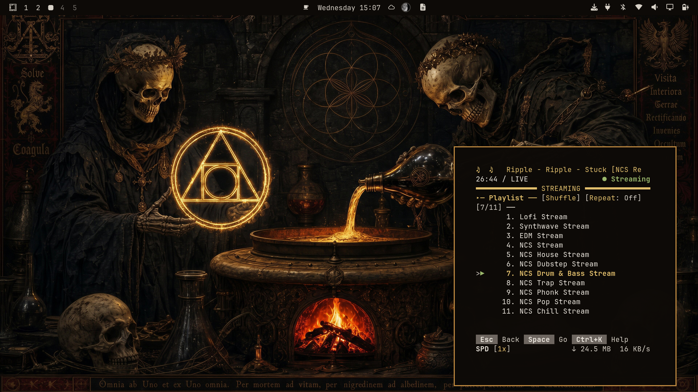

# Alchemy

> A dark, medieval memento mori theme for [Omarchy](https://omarchy.org/) —
> warm ivories, aged gold accents, and the quiet contemplation of the
> *danse macabre*. Built for those who like their desktops dark, warm, and
> timeless.

## Preview



## Installation

Install the theme either way:

**Via the Omarchy menu:** open the launcher (`Super` + `Space`), go to
**Install → Style → Theme**, and enter the GitHub link:

```
https://github.com/nico-m-dev/omarchy-alchemy-theme.git
```

**Or via the command line:**

```bash
omarchy theme install https://github.com/nico-m-dev/omarchy-alchemy-theme.git
```

Then apply it:

```bash
omarchy theme set alchemy
```

## Uninstalling

Themes you install appear under `~/.config/omarchy/themes/`. To remove this
one:

```bash
rm -rf ~/.config/omarchy/themes/alchemy
```

Then switch back to another theme (e.g. `omarchy theme set tokyo-night`). 

**Via the Omarchy menu:** open the launcher (`Super` + `Space`), go to **Remove → Theme**

## Backgrounds

Three original, 4K-optimized wallpapers — all in a dark medieval memento mori spirit:

| File             | Mood                                          |
| ---------------- | --------------------------------------------- |
| `1-alchemy.jpg`  | *Magnus Opus* — the alchemist's great work     |
| `2-alchemy.jpg`  | *Danse Macabre* — life and death in motion      |
| `3-alchemy.jpg`  | *Nigredo* — the blackening, the first stage    |

## Color palette

A warm, high-contrast dark palette — aged gold on deep, near-black warm browns.

| Role   | Color |
| ------ | ----- |
| Accent |  `#C08A3E` |
| Text   |  `#D8D2C8` |
| Bg     |  `#0D0A07` |
| Red    |  `#C05A4A` |
| Green  |  `#8AA65C` |
| Blue   |  `#5F7FA8` |

## License

[MIT](LICENSE)
